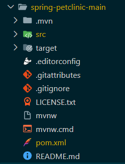
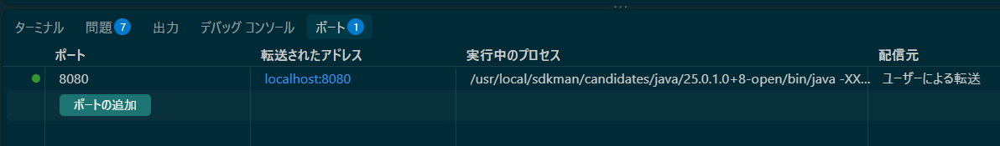
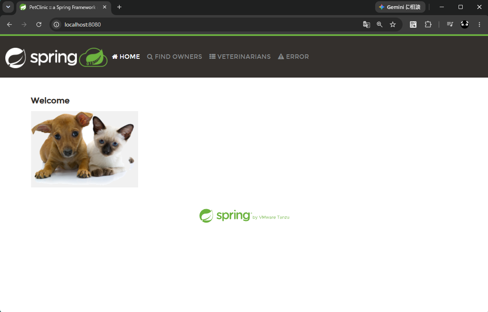
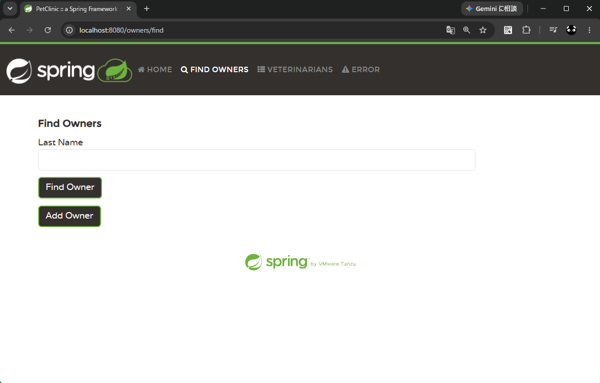
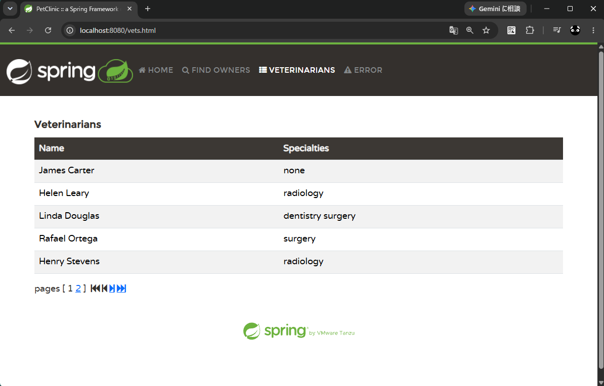
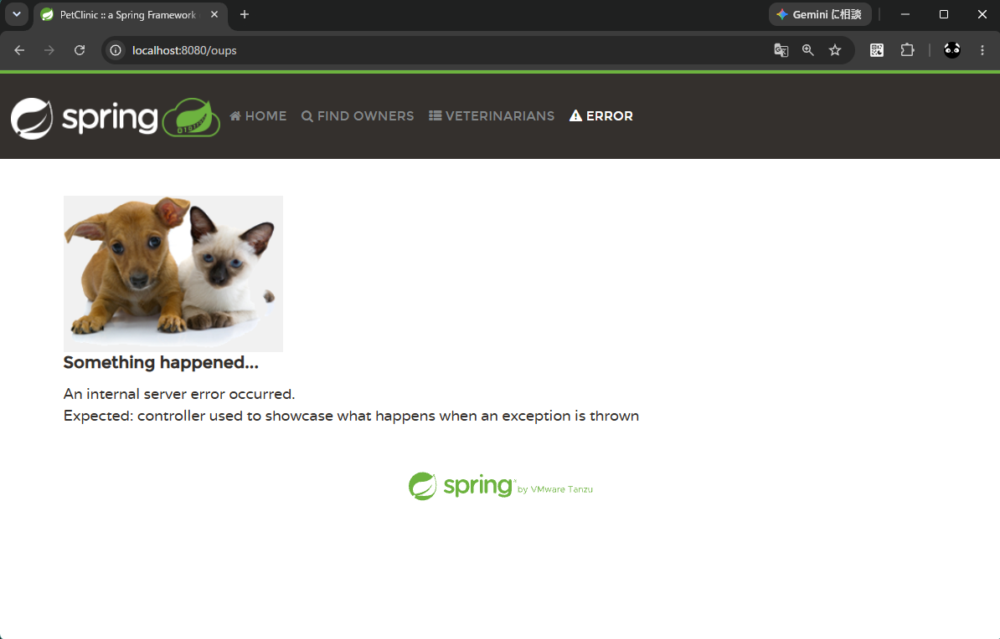
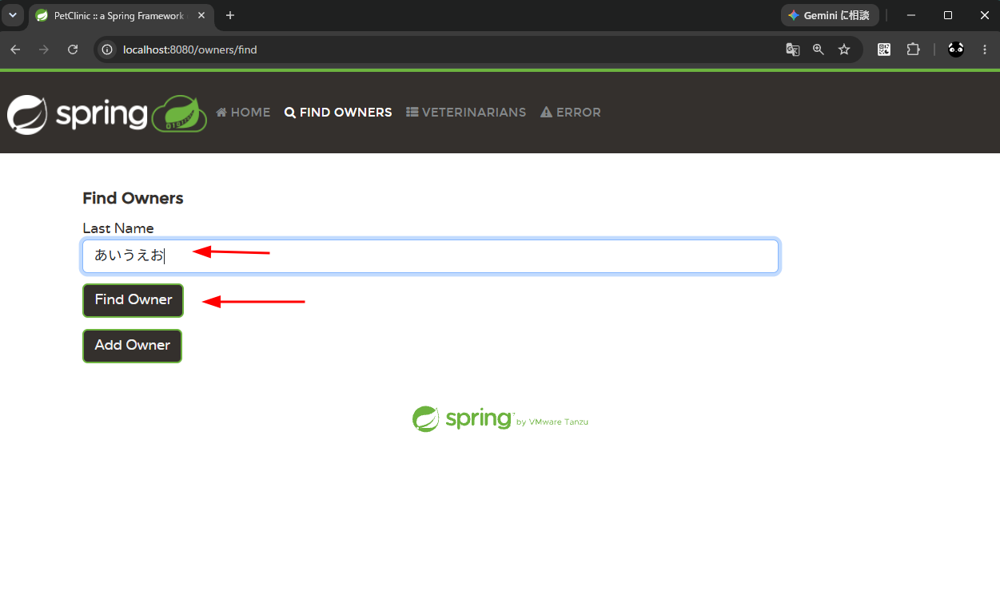
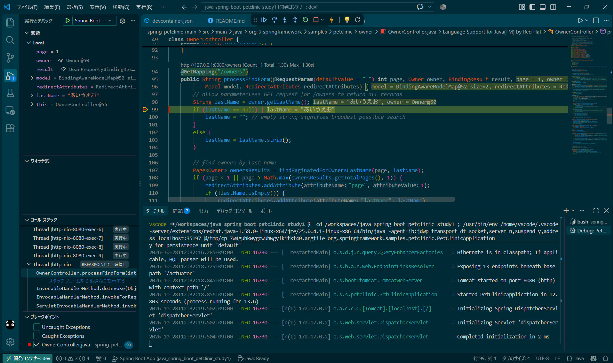

# java_spring_boot_petclinic_study1

## 概要

* Java + Spring Boot の勉強に Spring 公式の PetClinic サンプルアプリを動かしてみる

Spring PetClinic Sample Application  
https://github.com/spring-projects/spring-petclinic  

## 詳細

### 開発環境

※要 Docker or WSL コンテナー

* Visual Studio Code
* 拡張機能
  * Dev Containers

開発コンテナー
* Ubuntu 26.04
* Java 25
* 拡張機能
  * Extension Pack for Java
  * Spring Boot Tools

### PetClinic サンプルアプリを取得

```sh
# ダウンロード
curl -fsSL https://github.com/spring-projects/spring-petclinic/archive/refs/heads/main.zip \
  -o /tmp/spring-petclinic.zip

# 解凍　※カレントディレクトリに spring-petclinic-main フォルダが作成される
unzip /tmp/spring-petclinic.zip

# 一時ファイル削除
rm /tmp/spring-petclinic.zip
```

いらないものを消す（オプション）
```sh
rm -rf ./spring-petclinic-main/.devcontainer
rm -rf ./spring-petclinic-main/.github
rm -rf ./spring-petclinic-main/.gradle
rm -rf ./spring-petclinic-main/gradle
rm -rf ./spring-petclinic-main/k8s
rm ./spring-petclinic-main/.gitpod.yml
rm ./spring-petclinic-main/build.gradle
rm ./spring-petclinic-main/docker-compose.yml
rm ./spring-petclinic-main/gradlew
rm ./spring-petclinic-main/gradlew.bat
rm ./spring-petclinic-main/settings.gradle
```

消したあと  


### 実行

まずは普通に実行  
※デバッグ実行については後述（そっちの方が簡単）

```sh
cd ./spring-petclinic-main
./mvnw spring-boot:run
```
※`Started PetClinicApplication` と表示されるまでしばらく待つ

~~`8080` のポート転送を追加~~  
※wslc か VSCode かどちらの問題かは不明だが、ポート転送だとアプリを再起動した時に前の状態が残ったままになって、再起動後のアプリにつながらなくなる問題があった。  
ポート転送ではなく devcontainer の appPort で対応したため、本手順は不要



http://localhost:8080/ にアクセス

HOME  


FIND OWNERS  


VETERINARIANS  


ERROR  


※ERROR タブはエラーが起きた場合の表示サンプルで、既に問題が起きたから表示されているわけではない。以下で意図的に発生させた例外の内容が表示されている。

spring-petclinic-main/src/main/java/org/springframework/samples/petclinic/system/CrashController.java
```java
@Controller
class CrashController {

	@GetMapping("/oups")
	public String triggerException() {
		throw new RuntimeException(
				"Expected: controller used to showcase what " + "happens when an exception is thrown");
	}

}
```

デバッグ実行(F5)

`Completed initialization` と表示されるまで待つ

ブレークポイントなどもちゃんと使える



